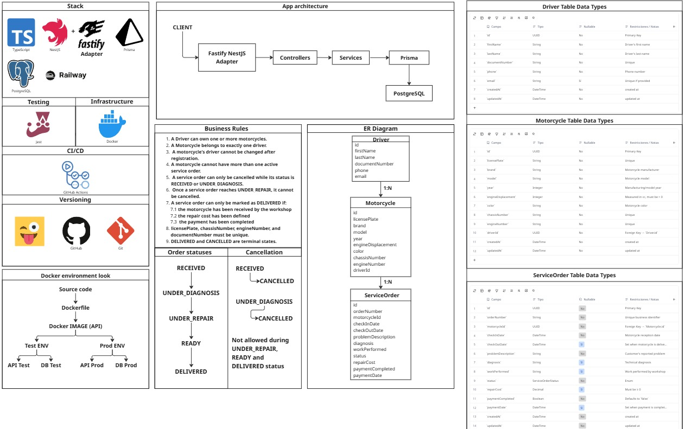

<div align="center">

# 🏍️ Motorcycle Workshop API

**RESTful API for managing a motorcycle repair workshop** — drivers, their motorcycles, and the service orders opened for each repair.

[](https://github.com/BasHdezDev/motorcycle-workshop-api/actions/workflows/deploy-gcp.yml)
[](https://github.com/BasHdezDev/motorcycle-workshop-api/releases)
[](#)

</div>

---

## 🧭 Planning Board

The full architecture, business rules, ER diagram, and data types were planned before writing any code. You can explore the interactive board here:

**🔗 [View the Miro planning board](https://miro.com/app/board/uXjVHx37ckw=/?share_link_id=623223523014)**



---

## 🛠️ Tech Stack

<div align="center">

| Layer | Technology |
|---|---|
| Language |  |
| Framework |  (Fastify adapter) |
| ORM |  |
| Database |  |
| Testing |  |
| Containerization |  |
| Infrastructure as Code |  (v3) |
| CI/CD |  |
| Hosting |  (v3) — previously Railway (v1) and GKE (v2) |

</div>

---

## 🏗️ Architecture

```text
CLIENT → Fastify NestJS Adapter → Controllers → Services → Prisma → PostgreSQL
```

## 📦 Entities

| Entity | Description |
|---|---|
| `Driver` | A person who owns one or more motorcycles. |
| `Motorcycle` | Belongs to exactly one driver. |
| `ServiceOrder` | A repair/maintenance record for one motorcycle. |

**Relationships:** `Driver` 1─N `Motorcycle` 1─N `ServiceOrder`

## 📐 Business Rules

1. A driver can own one or more motorcycles.
2. A motorcycle belongs to exactly one driver.
3. A motorcycle's driver **cannot be changed** after registration.
4. A motorcycle cannot have more than one **active** service order at a time.
5. `licensePlate`, `chassisNumber`, `engineNumber`, and `documentNumber` must be unique.
6. A driver cannot be deleted while they have registered motorcycles.
7. A motorcycle cannot be deleted while it has associated service orders.

### Service Order lifecycle

```text
RECEIVED → UNDER_DIAGNOSIS → UNDER_REPAIR → READY → DELIVERED
```

- Transitions only move forward, one step at a time — no skipping, no going back.
- **Cancellation** (`PATCH /service-orders/:id/cancel`) is only allowed while the order is `RECEIVED` or `UNDER_DIAGNOSIS`.
- An order can only be marked **`DELIVERED`** if `repairCost` has been set and `paymentCompleted` is `true`.
- `DELIVERED` and `CANCELLED` are **terminal states** — no further changes (status or otherwise) are allowed once an order reaches either one.
- `ServiceOrder` has no `DELETE` endpoint — deleting an order would erase repair history and break traceability. Orders are "closed" via cancellation or delivery instead.

---

## 📡 API Endpoints

All list endpoints (`GET /drivers`, `GET /motorcycles`, `GET /service-orders`) support pagination via `?page=1&limit=10` (default `page=1`, `limit=10`, max `limit=100`) and return:
```json
{
  "data": [ ... ],
  "meta": { "total": 42, "page": 1, "limit": 10, "totalPages": 5 }
}
```

All resources also support the **`QUERY`** verb for filtered search (e.g. `QUERY /drivers` with body `{"firstName":"Juan"}`).

### Drivers
| Method | Endpoint | Description |
|---|---|---|
| POST | `/drivers` | Create a driver |
| GET | `/drivers` | List drivers (paginated) |
| GET | `/drivers/:id` | Get a driver by id |
| PATCH | `/drivers/:id` | Update a driver |
| DELETE | `/drivers/:id` | Delete a driver |
| QUERY | `/drivers` | Search drivers by filters |

### Motorcycles
| Method | Endpoint | Description |
|---|---|---|
| POST | `/motorcycles` | Register a motorcycle |
| GET | `/motorcycles` | List motorcycles (paginated) |
| GET | `/motorcycles/:id` | Get a motorcycle by id |
| PATCH | `/motorcycles/:id` | Update a motorcycle |
| DELETE | `/motorcycles/:id` | Delete a motorcycle |
| QUERY | `/motorcycles` | Search motorcycles by filters |

### Service Orders
| Method | Endpoint | Description |
|---|---|---|
| POST | `/service-orders` | Open a new service order |
| GET | `/service-orders` | List service orders (paginated) |
| GET | `/service-orders/:id` | Get a service order by id |
| PATCH | `/service-orders/:id` | Update plain fields (diagnosis, cost, etc.) |
| PATCH | `/service-orders/:id/status` | Advance the order to the next status |
| PATCH | `/service-orders/:id/cancel` | Cancel an order |
| QUERY | `/service-orders` | Search orders by filters |

### Health
| Method | Endpoint | Description |
|---|---|---|
| GET | `/health` | Liveness check — verifies DB connectivity and reports app version |

Interactive Swagger documentation is served at `/api`.

---

## 🚀 Getting Started

### Prerequisites
- Node.js 22+
- Docker & Docker Compose

### Environment variables
Copy `.env.example` to `.env` and fill in the values.

### Run with Docker (recommended)
```bash
docker-compose up -d --build
```
The compose file starts PostgreSQL, runs the Prisma migrations once through a one-off `migrate` service, and only then starts the API. The API will be available at `http://localhost:3000` (it listens on port 8080 inside the container).

### Run locally (with hot-reload)
```bash
npm install
docker-compose up -d postgres   # only the database
npx prisma migrate deploy       # apply the migrations
npm run start:dev
```

### Run tests
```bash
npm run test        # unit tests
npm run test:cov    # tests + coverage report
```

---

## 🔁 CI/CD

The current pipeline (v3) is `.github/workflows/deploy-gcp.yml`:

```text
build → terraform (fmt · validate · plan · apply on demand) → deploy (image · migrations · Cloud Run · health check)
```

| Trigger | What runs |
|---|---|
| Push to `main` (ignoring `*.md` and `docs/`) | build, Terraform plan, image build and push, migrations, deploy, `/health` check |
| Manual run (`workflow_dispatch`) | the same, plus Terraform `apply` when `apply_infrastructure=true` |

GitHub authenticates to Google Cloud with **Workload Identity Federation**: no service account keys are stored in GitHub, and only this repository and the allowed branches are trusted. Infrastructure changes are never applied automatically, and the pipeline never runs `terraform destroy`.

### Legacy pipelines (v1 and v2)

Versions 1 and 2 used two independent Railway pipelines, each running **build → test → coverage gate → deploy → health verification**. They were removed from the repository in v3 and remain available in the history up to the `v2.1.0` tag.

| Pipeline | Trigger | Coverage threshold | Deployed to |
|---|---|---|---|
| `testing.yml` | Push to any branch except `main` | ≥ 60% | Testing environment (Railway) |
| `production.yml` | Push to `main` | ≥ 85% | Production environment (Railway) |

## 🌎 Live Environments

| Environment | URL |
|---|---|
| **v3 — Google Cloud Run** | `https://workshop-v3-api-xy265jzv4a-uc.a.run.app` (Swagger at `/api`) |
| Production (v1) | `https://motorcycle-workshop-api-production.up.railway.app` |
| Testing (v1) | `https://motorcycle-workshop-api-testing.up.railway.app` |
| API B and Orchestrator (v2, GKE) | Torn down after the v2 delivery |

> The v3 environment exists only while its infrastructure is deployed. It is destroyed with `terraform destroy` after the evaluation (see the [v3 section](#️-api-v3--infrastructure-as-code-on-google-cloud)), so the URL will not respond afterwards.

---

## 🧩 API v2 — Multicloud Integration

Version 2 evolves the project from a single API into a **multicloud microservices
architecture**, integrating with a partner API hosted on a different cloud
provider through a dedicated Orchestrator service.

```text
Client
  │
  ▼
Orchestrator (GKE) ──────► API B (this project, GKE + Cloud SQL)
  │
  └───────────────────────► API A (partner, AWS)
```

Both APIs expose independent `v2` routes (`/api/v2/*` here, `/v2/*` on the
partner side) that never call each other directly — all cross-cloud
communication is brokered exclusively by the Orchestrator, so a failure on
either side degrades gracefully instead of cascading.

### 🛠️ v2 Tech Additions

<div align="center">

| Layer | Technology |
|---|---|
| Container orchestration |  (GKE Autopilot) |
| Managed database |  (PostgreSQL) |
| Image registry |  |
| Async messaging |  (topic + DLQ) |
| Cross-cloud identity | Workload Identity (GKE ↔ GCP service accounts) |

</div>

### 📡 New v2 Endpoints (API B)

All `v2` routes live under `/api/v2` and require the `x-api-key` header
(except `/api/v2/health`).

| Method | Endpoint | Description |
|---|---|---|
| GET | `/api/v2/health` | Health check for the v2 surface (no auth) |
| GET | `/api/v2/drivers`, `/motorcycles`, `/service-orders` | Same CRUD as v1, reusing existing business logic |
| GET | `/api/v2/service-orders/interop/random` | Returns a random **active** service order in the shared multicloud contract format (`source`, `kind`, `id`, `label`, `attributes`, `retrievedAt`) |
| GET | `/api/v2/service-orders/:id` | Returns the order **enriched with a `partner` field** — a live record fetched from API A through the Orchestrator |

**`partner.status` values:**

| Value | Meaning |
|---|---|
| `ok` | Orchestrator responded with a valid record |
| `unavailable` | Orchestrator/partner errored, timed out (1.5s), or returned malformed data — **the local order is still returned** |
| `disabled` | No Orchestrator configured — not even attempted |

> Design principle: a failure on the partner's cloud must never turn a
> perfectly good local read into an error.

> In v3 the GKE deployment is gone and the Orchestrator is not deployed, so on Cloud Run the `partner.status` is always `disabled` and the rest of the API behaves the same.

### 🎭 The Orchestrator

A separate, independently deployable NestJS service (`orchestrator/`, own
`package.json` and Dockerfile, same repository) exposing:

| Method | Endpoint | Description |
|---|---|---|
| POST | `/api/v2/flujo` | Demonstrates the full saga-lite flow: trace-id → correlation-id → calls API B → calls API A → publishes an async event to Pub/Sub |
| GET | `/interop/:api/random` | Proxies to `inventory` (API A) or `orders` (API B), injecting the right API key and propagating `X-Correlation-Id` |
| GET | `/metrics/:api` | Proxies raw Prometheus-format metrics from either API |

### 📨 Async Messaging (Pub/Sub)

| Resource | Name |
|---|---|
| Topic | `flujo-v2` |
| Subscription | `flujo-v2-sub` (5 delivery attempts, exponential backoff) |
| Dead Letter Topic | `flujo-v2-dlq` |
| Dead Letter Subscription | `flujo-v2-dlq-sub` |

### 🔑 Additional v2 Environment Variables

```env
API_KEY=
ORCHESTRATOR_URL=
ORCHESTRATOR_API_KEY=
INTEROP_TIMEOUT_MS=1500
PUBSUB_PROJECT_ID=
PUBSUB_TOPIC=
```

---

## ☁️ API v3 — Infrastructure as Code on Google Cloud

Version 3 replaces the Kubernetes and multicloud setup with a simpler, cheaper serverless stack on Google Cloud. All the infrastructure is declared with **Terraform**, deployed by a GitHub Actions pipeline, and removable with a single documented `terraform destroy`. The v3 stack is fully independent from earlier deliveries: its own project, state, and resource names.

```text
Developer → GitHub → GitHub Actions
                        │  Workload Identity Federation (no JSON keys)
                        ├─ build
                        ├─ terraform: fmt · validate · plan (apply on demand)
                        └─ deploy: image → migrations (Cloud Run Job) → Cloud Run → /health

Client ──HTTPS──► Cloud Run (NestJS) ──Unix socket──► Cloud SQL for PostgreSQL
                      │
                      └─ Secret Manager (DATABASE_URL, API_KEY)
```

### 🛠️ v3 Tech Additions

<div align="center">

| Layer | Technology |
|---|---|
| Infrastructure as Code |  (modular, one file per service) |
| Compute |  (service + one-off migration job) |
| Database |  (PostgreSQL 17) |
| Image registry |  |
| Secrets |  |
| Identity | IAM service accounts + Workload Identity Federation |

</div>

### 📦 What Terraform creates (about 40 resources)

| Service | Resources | File |
|---|---|---|
| Cloud SQL for PostgreSQL | Instance (`db-f1-micro`), database `motorcycle_workshop`, application user with a generated password | `cloud_sql.tf`, `database.tf` |
| Cloud Run | `workshop-v3-api` service (0–2 instances) with public HTTPS access | `cloud_run.tf` |
| Cloud Run Job | `workshop-v3-migrate`, runs `prisma migrate deploy` once per deployment | `cloud_run_job.tf` |
| Artifact Registry | Docker repository for the API image | `artifact_registry.tf` |
| Secret Manager | `DATABASE_URL` and `API_KEY` secrets | `secrets.tf` |
| IAM | `runtime` and `deployer` service accounts with their roles | `iam.tf` |
| Workload Identity Federation | Pool and OIDC provider for GitHub Actions | `workload_identity.tf` |
| Enabled APIs | Google Cloud APIs required by the services above | `apis.tf` |

Supporting files: `versions.tf`, `provider.tf`, `backend.tf` (remote state in a GCS bucket), `variables.tf`, `outputs.tf`, and `terraform.tfvars.example`.

### 🧠 Design decisions

- **Scale to zero:** Cloud Run runs with no minimum instances, so there is no compute cost without traffic.
- **One connection strategy:** Cloud Run connects to Cloud SQL through the official integration and a Unix socket. The instance has a public IP but **no authorized networks**, so it is not reachable from the Internet.
- **No passwords in the repository:** Terraform generates the database password and the API key, and they live only in Secret Manager.
- **Migrations run once:** a Cloud Run Job runs the Prisma migrations before each deployment, instead of every container running them at startup.
- **Keyless deployment:** GitHub Actions authenticates with Workload Identity Federation, restricted to this repository and the allowed branches.
- **Least privilege for the API:** the runtime service account can only connect to Cloud SQL and read its two secrets.
- **Controlled applies:** infrastructure changes are applied only through a manual run, and the pipeline never runs `terraform destroy`.

### ⚡ Quick start

```powershell
cd terraform
Copy-Item terraform.tfvars.example terraform.tfvars   # then edit the values
terraform init
terraform validate
terraform plan
terraform apply
terraform output -raw cloud_run_url
```

The first creation is always done from a terminal; after that, the pipeline keeps the infrastructure in sync. Full instructions (prerequisites, variables, authentication, manual image build, migrations, verification and costs) are in **[`terraform/README.md`](terraform/README.md)**.

### 🧹 Teardown

```powershell
cd terraform
terraform plan -destroy
terraform destroy
```

This deletes every resource managed by the v3 state, **including the Cloud SQL data and the images in Artifact Registry**. The `terraform/README.md` explains what is lost, how to clean up the state bucket, and how to check that no billable resources remain.

### 💰 Cost

Cloud SQL is the only resource that bills while it exists, even without traffic: roughly 0.30 to 0.40 USD per day for the smallest shared-core instance. Cloud Run, Artifact Registry and Secret Manager cost cents at this scale. There is no GKE, load balancer, NAT or Pub/Sub.

### 🔧 What changed in the application for v3

- The container listens on the `PORT` provided by Cloud Run (8080) and starts with `node dist/src/main.js`; the `start:prod` script now points to the same path.
- The container no longer runs migrations at startup (the old `docker-entrypoint.sh` was removed); `docker-compose` has a one-off `migrate` service instead.
- The orchestrator code remains in the repository but is excluded from the Docker image and the API build.
- `package.json` version bumped to `3.0.0`, which Swagger and `/health` report.

### 🔑 v3 Environment Variables (Cloud Run)

| Variable | Source |
|---|---|
| `PORT` | Injected by Cloud Run |
| `NODE_ENV` | `production`, set by Terraform |
| `DATABASE_URL` | Secret Manager (generated by Terraform) |
| `API_KEY` | Secret Manager (generated by Terraform) |

The v2 variables for the orchestrator and Pub/Sub are not set in v3.

---

## 📌 Versioning

This project follows [Semantic Versioning](https://semver.org/). See the [Releases](https://github.com/BasHdezDev/motorcycle-workshop-api/releases) page for the changelog, and `GET /health` for the version currently deployed.

## 📈 Project Status

- [x] Project setup (NestJS + Fastify + Prisma + PostgreSQL)
- [x] Docker & Docker Compose
- [x] Driver, Motorcycle & ServiceOrder CRUD
- [x] QUERY verb search endpoints
- [x] Automated tests (Jest) with coverage above rubric thresholds
- [x] CI/CD pipelines for Testing and Production (v1–v2, Railway)
- [x] Cloud deployment (Railway)
- [x] Health check with DB connectivity verification
- [x] Unified error handling
- [x] Pagination on list endpoints
- [x] Swagger / OpenAPI documentation
- [x] API v2 with independent, API-key-protected routes
- [x] Dockerized and deployed to GKE (Kubernetes)
- [x] Managed PostgreSQL via Cloud SQL with Workload Identity
- [x] Multicloud integration via a dedicated Orchestrator service
- [x] Async messaging with Pub/Sub (topic, subscription, DLQ, retries)
- [x] Cross-cloud correlation ID tracing
- [x] Infrastructure as code with Terraform (modular, one file per service)
- [x] Cloud Run, Cloud SQL, Artifact Registry, Secret Manager and IAM created with Terraform
- [x] Keyless GitHub Actions pipeline (Workload Identity Federation): build, Terraform plan, migrations, deploy and health check
- [x] Database migrations as a one-off Cloud Run Job
- [x] Documented and tested teardown with `terraform destroy`
- [x] Release v3.0.0
Test